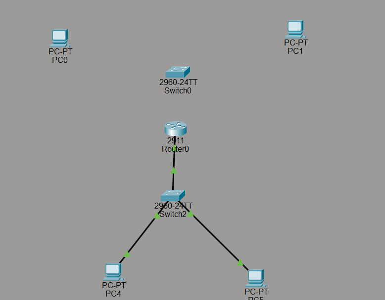

After the documentation in `BasicDocumentation.md`, we'll continue by adding another switch to the router, just in case all the ports on the first switch are being used!

This process is basically the same as in the basic documentation. You'll just need to use a different port and possibly a slightly different IP address. We'll go trough it together :3

Anyways, let's get started! First, we'll do the same thing as before by adding a switch and two PCs.

Next, we'll use Ethernet ports to connect the PCs to the switch, then connect the switch to the router's Gigabit Ethernet port. Remember to use a Gigabit Ethernet port when connecting the switch to the router. For the second switch, we'll use the Gigabit Ethernet 0/1 port.

