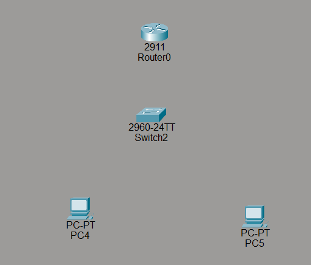
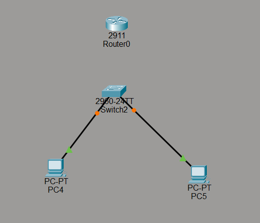
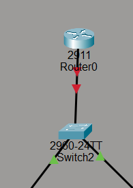
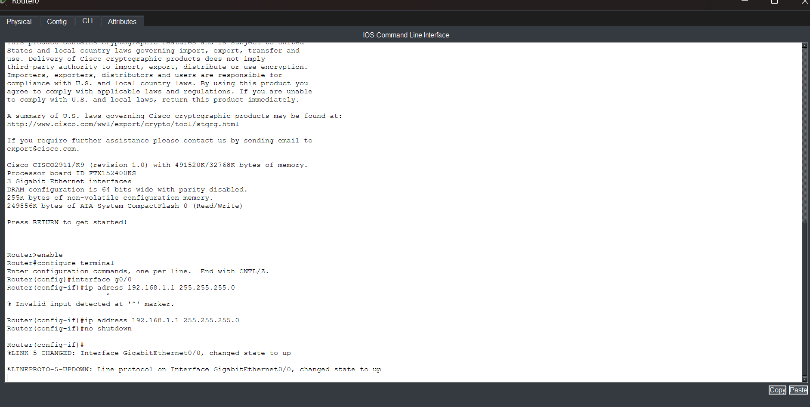
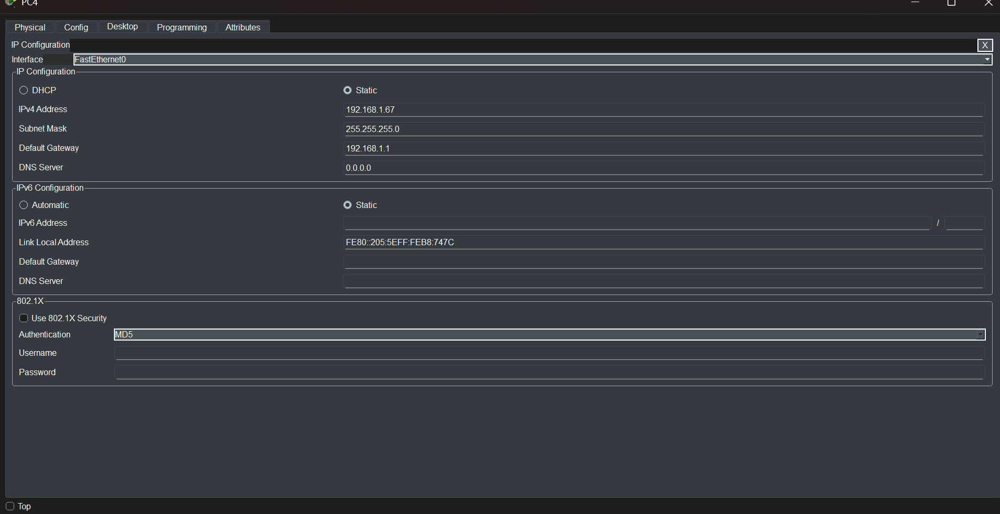
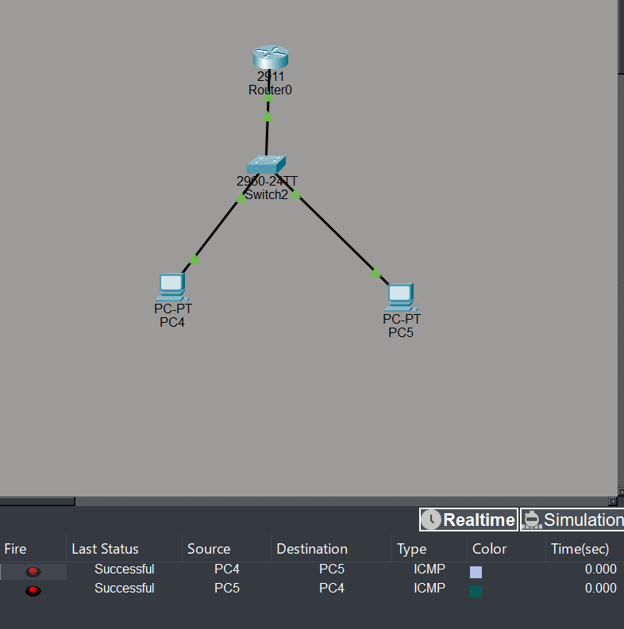

This is what we're trying to achieve: a basic network that allows me to send PDUs between computers through a router.

We will be using the Cisco 2911 router because it is a suitable model for practicing basic routing. We will also use Cisco 2960 switches to connect multiple computers to the network, as the router has a limited number of physical Ethernet interfaces. Finally, we will add two more computers.

We will use Copper Straight-Through cables to connect the computers to the switches and the switches to the router. First, select the Copper Straight-Through cable, click on a computer, and connect the cable to its FastEthernet0 port. Then, click on the switch and connect the other end to a FastEthernet port, such as FastEthernet0/1. Repeat these steps for the other computers, using a different Ethernet port on the switch for each computer.

We will use the gigabit Ethernet port on the switch to connect it to the router.

Now, we'll move on to the configuration part. We need to configure the Gigabit Ethernet port that we used earlier to connect the switch to the router.

1. Open the CLI on the router.
2. Press **Enter** to get started.
3. Type `enable` to enter privileged EXEC mode.
4. Type `configure terminal` to enter global configuration mode.
5. Type `interface g0/0` to enter the configuration mode for the first Gigabit Ethernet port.
6. Type `ip address 192.168.1.1 255.255.255.0` to assign an IP address and subnet mask to the interface.

   **Important note:** You can use a different number for the last octet of the IP address, as long as it is a valid host address that doesn't conflict with another device on the same network. For now, I'm using `1` because it's simple.

7. Type `no shutdown` to enable the interface. Once you're done, you can exit the CLI.

We can also configure `g0/1` if we need to connect another switch to the router. However, we'll need to use an appropriate IP address for that interface, typically on a different subnet if the interfaces connect to separate networks. We must also ensure that the IP address doesn't conflict with any other device's address.

Next, we'll configure the PC's IP address as well.

1. Open the PC, go to the **Desktop** tab, and click **IP Configuration**.
2. Enter the IPv4 address. For the host portion (the last number), you can choose any valid number that isn't already being used by another device on the same network. I'll use `67` because it's funny, but feel free to choose any valid number.
3. Set the subnet mask to the usual `255.255.255.0`.
4. Set the default gateway to the router's IP address. In my case, the router's IP address is `192.168.1.1`.

Repeat the same steps for the other computer. Remember that each computer must have a **unique IP address** on the same network, so you cannot assign both computers the same host address.

And there you go! You should now be able to send PDUs to the other computer. If the PDU still shows **Failed**, the network might need a bit more time to process everything. Just fast-forward the simulation a little, and the PDU should eventually show **Successful**. Good stuff :3

