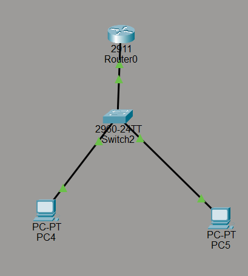

This project is for practicing basic network configuration and sharing images of my documentation.

- **Images folder:** Contains images to be used in the documentation.
- **Documentation file:** Where I will document my work and progress.

**Project 1: Basic Network Configuration**

This project covers the basic network configuration using one router, one switch, and two computers.

For detailed instructions, please refer to `documentation.md`.
