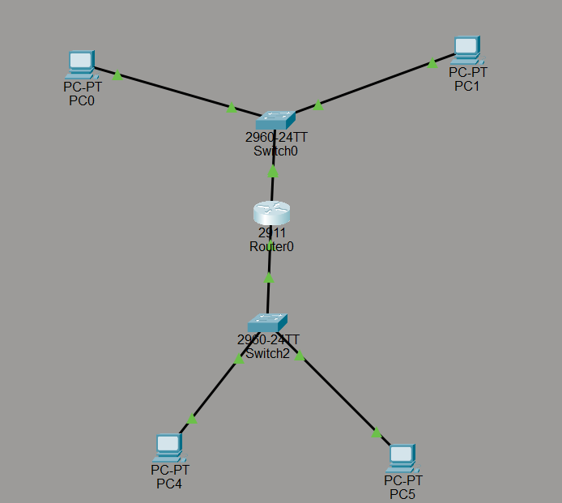

This project is for practicing basic network configuration and sharing images of my documentation.

- **img:** This folder contains images used in the documentation.
- **BasicDocumentation.md:** This file documents my work and progress on the basic network configuration.
- **2ndNetworkDocumentation.md:** This file documents my work and progress on adding a second network.

## First Project: Basic Network Configuration

This project covers basic network configuration using one router, one switch, and two computers.

For detailed instructions, please refer to `BasicDocumentation.md`.

You can also check out `basicnetwork.pkt` to explore the basic network configuration in Cisco Packet Tracer.

## Second Project: Adding a Second Network

This project builds on the previous one by adding another switch and two more computers, creating two separate networks connected to a single router.

For detailed instructions, please refer to `2ndNetworkDocumentation.md`.

